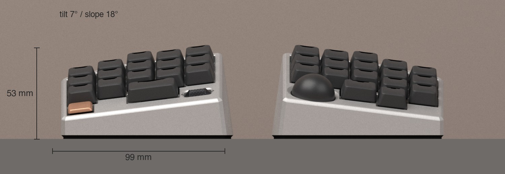
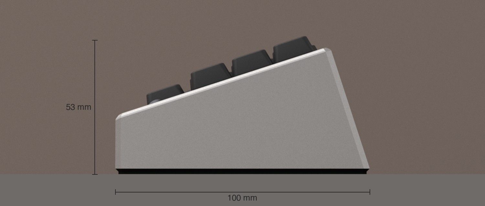
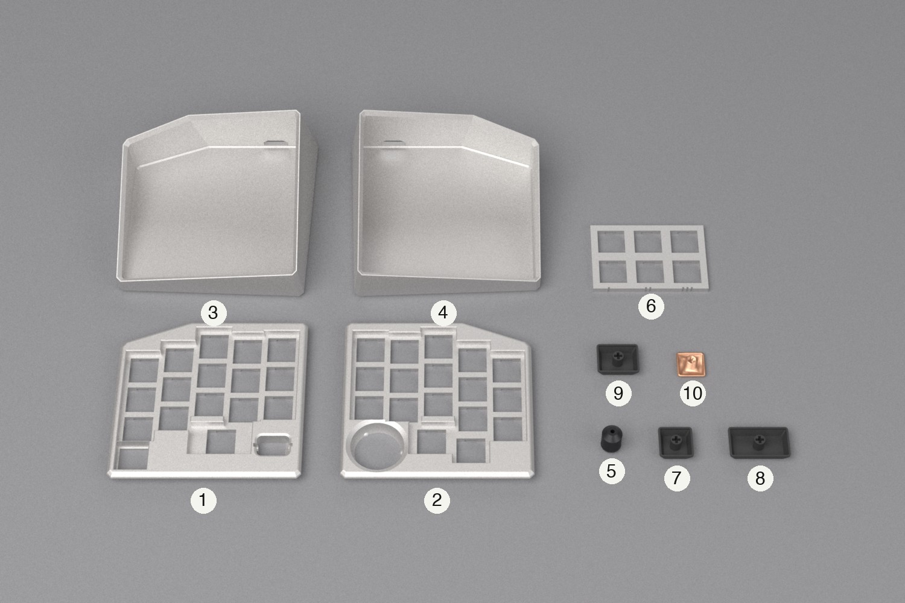

# Omnis A案ケース（版A-2）

Omnisの左右それぞれを「プレート」と「傾斜台」に分けた、3Dプリンター用の試作ケースです。版A-2は参考画像（`reference/chamfer-inner-wheel.jpg`）の見た目を再現することを優先して作り直しました。スイッチはKailh Choc V2、キーのピッチは17 mmです。形はPythonで作っていて、寸法や姿勢を変えてSTLを出し直せます。


上が参考画像、下がA-2のプレビュー（`preview/hero.jpg`）です。同じカメラで、手前のやや上から左右を並べて見ています。

キー面は奥と内側（親指側）が高くなります。左右に7°、前後に18°傾いていて、合わせた傾きは19.4°です。docs/concept.md にある小人キーの立てた姿勢（版A-1では左右43°）とはずれますが、A-2では参考画像の見た目を優先しました。左右に43°立てた傾斜台も、同じプレートのまま出せます（「姿勢だけを変える」）。

## 参考画像の姿勢

版A-1のREADMEには、参考画像のケースは左右に約20°傾いていると書きました。測り直すと、これは誤りでした。参考画像のキー面は左右にはあまり傾いておらず、奥へ上がっています。

参考画像の左のケースで、壁の高さを読みました。手前の壁は低い台形で、外側の端が約12 mm、内側の端が約22 mmです。内側の壁は奥ほど高く、奥の角で約50〜55 mmあります。幅93 mm、奥行き88 mmのキー面に当てはめると、左右に約6〜7°、前後に約18〜22°の傾きになります。キーの位置から求めても、左右8〜10°、前後14〜21°でした。A-2は左右7°、前後18°にしました。

| 上面の角 | 参考画像から読んだ高さ | A-2 |
| --- | --- | --- |
| 外側の手前 | 約12 mm | 12.0 mm |
| 内側の手前 | 約22 mm | 23.4 mm |
| 内側の奥 | 約50〜55 mm | 50.6 mm |
| 外側の奥 | 隠れていて読めない | 39.3 mm |

A-2の値は面取りをする前の角の位置です。左右だけに20°傾けた形は、手前の壁が高い三角形になり、キーが外側を向くので、参考画像とは別の形に見えます。





座った目の高さから見た図は `preview/seat.jpg`、プレートを平らに置いて真上から見た図は `preview/layout.jpg` にあります。

## 参考画像に合わせた所

| どこを | どう作ったか |
| --- | --- |
| 姿勢 | キー面は左右7°、前後18°。いちばん低い外側の手前で12 mm、いちばん高い内側の奥で50.6 mm |
| 側面 | 机から立ち上がる壁と、その上の面取りの帯の2段。手前と外側の壁は垂直。帯は幅1.5 mmの面取りで、上下の縁をさらに0.35 mm落として丸く見せる |
| 内側の壁 | 垂直から7°寝かせた1枚の面（参考画像は約7〜8°）。上の帯が奥へ向かって上がっていく |
| 縦の角 | 四隅を2.2 mmの面取りで落とす。帯とぶつかる所に小さな三角の面ができる |
| 底の台 | 壁の下端から1.2 mm引っ込んだ、高さ2.2 mmの台（上の1.2 mmは45°の斜面）。黒にするときは、ここまでを黒で印刷する |
| 球のまわり | 穴のふちを、幅2.2 mm、深さ1.3 mmの輪の形になだらかに落とす |
| ホイールのまわり | 窓の角を半径2.5 mmで丸め、ふちを幅1.0 mm、深さ0.7 mmで斜めに落とす |
| キーのくぼみ | ふちを0.4 mm面取りする |
| キーキャップ | プレビューでは、角と縁を丸めた形で描く。描くだけで、印刷用のキャップ（`stl/keycap_*.stl`）の形は変えていない |

## 参考画像との違い

印刷の都合や、キーの配置を変えない条件のために、参考画像と同じにできなかった所です。上から、見た目への影響が大きい順に並べました。

| どこが | 参考画像 | A-2 | なぜ |
| --- | --- | --- | --- |
| キーのまとまりの大きさ | キーが上面の幅いっぱいに並び、縁は約1〜3 mm | 縁は外側3.3 mm、内側4.2 mm、奥3.6 mm。キーのまとまりが一回り小さく見える | 縁の下に、傾斜台の壁（2.4 mm）とプレートの差し込み部の肉を取るため。参考画像では、キー5列ぶんの幅が上面の幅とほぼ同じに描かれている（上面の幅を93 mmとすると、列の間隔は約19 mmに当たる）。A-2は依頼の条件の17 mmピッチ |
| キーキャップ | 背が高く、側面が大きく絞られている | プレビューのキャップは上面から7.7 mm出る。印刷用のキャップは6.0 mm | プレビューは見た目を参考画像に寄せた。印刷用は、Choc V2のストロークとハウジングの公差から高さを決めている |
| 列のずれ | 内側の人差し指の列がいちばん奥に見える | 中指を基準に、小指−14、薬指−8、人差し指−3、内側の人差し指−2 mm | 依頼の条件の「中指の列は奥、小指の列は手前」に合わせた。この条件で、キーの配置は変えていない |
| 球の位置と出方 | 内側と手前の縁に接するほど角に寄り、半分以上が上面から出る | 中心が内側の縁から17.7 mm、手前の縁から16.7 mm。直径の46%（11.4 mm）が出る | 位置は版A-1のまま変えていない。穴と差し込み部の側面の間に肉が要る |
| ホイール | 窓が約17×9 mm。内側の縁のすぐ脇 | 直径10 mm、長さ14.4 mm。窓は15.8×11.0 mmで、内側の縁から6.3 mm離れる | 位置は版A-1のまま変えていない。軸を受ける溝のまわりに肉が要る |
| ホイールのまわりの弧 | 内側の縁の帯が、ホイールの脇で弧を描いて広がる | 帯の幅は一定 | 参考画像から立体の形を読み切れなかった。帯を広げると、内側の縁の肉が減る |
| 合わせ目 | なし | 面取りの帯のすぐ下（上面から2.2 mm下）に、細い線が一周する | 姿勢だけ作り直せるよう、プレートと傾斜台を別の部品にしたため。線は帯の下の縁に寄せた |
| 奥の壁 | 見えない | 垂直から18°寝かせる（キー面に垂直） | キーを押す力はキー面に垂直で、奥へ向く。奥の壁を寝かせて足もとを奥へ広げると、力の向きが足の外へ出ない。プレートの差し込み部もまっすぐ抜き差しできる |
| 奥の外側の角 | 見えない | 斜めに落とした（幅34 mm、奥行き12.4 mm） | キーのない上面を減らすため |
| 左の親指キー | 幅が約2uで、少し回っている | 幅1.75u（29.25 mm）で、回していない | 版A-1のまま変えていない。2uだと薬指の列の手前のキーに当たる |
| 右の親指キー | 幅広のキーが2個 | 1.25u（Enter）と1uが1個ずつ | 版A-1のまま変えていない。球の穴と薬指の列の間に収めるため |
| 音声入力キー | 約12 mm角で、くぼみに沈む | 14 mm角。スイッチを1.8 mm沈め、キャップは上面から2.7 mm出る | Choc V2のつば（15 mm角）をくぼみに通すため。14 mm角のキャップはハウジングをまたげない |
| ホイールの表面 | 細かいあや目 | 18条、深さ0.45 mmの粗いあや目 | 0.4 mmのノズルで出せる細かさに合わせた |
| 底と奥の壁 | 見えない | 底は厚さ2.2 mmの板で閉じている。開口は奥の壁の窓1つ（幅13 mm、高さ7 mm。下端は底の板の上面から1.6 mm上） | A-2には基板もコネクターの取り付けもなく、配線したケーブルを外へ出す穴が1つ要る。ケーブルをプラグごと通すことを考えた大きさにとどめた |
| 底の目印 | 見えない | 底の四隅に、ゴム足を貼る位置を示す輪の溝（幅0.8 mm、深さ0.4 mm） | ゴム足の位置を決めるため。底を貫いてはいない |
| 素材と表面 | 梨地のアルミ | PLA。積層の筋が出る | 試作は3Dプリンターで作るため |

版A-1にあったSpaceとホイールの間の仕切り（高さ2.2 mmの畝）は、参考画像にないので外しました。付けるときは `--set lip_h=2.2` で出し直します。

## 印刷する部品



STLはどれも印刷する向きで保存してあります。スライサーに読み込んだら、向きを変えずに造形面へ置いてください。番号は上の図と同じです。

| 番号 | ファイル | 部品 | 造形面に置く面 | サポート | 印刷時間 | 重さ |
| --- | --- | --- | --- | --- | --- | --- |
| 1 | `stl/left_plate.stl` | 左のプレート | 下面 | 不要 | 49分 | 17.0 g |
| 2 | `stl/right_plate.stl` | 右のプレート | 下面 | 不要 | 47分 | 16.0 g |
| 3 | `stl/left_base.stl` | 左の傾斜台 | 底（机に置く向き） | 不要 | 1時間18分 | 43.5 g |
| 4 | `stl/right_base.stl` | 右の傾斜台 | 底（机に置く向き） | 不要 | 1時間17分 | 43.5 g |
| 5 | `stl/left_wheel.stl` | ホイール | 端面（軸を立てる） | 不要 | 14分 | 0.8 g |
| 6 | `stl/fit_test.stl` | スイッチ穴の試し刷り | 下面 | 不要 | 16分 | 3.6 g |
| 7 | `stl/keycap_1u.stl` | キーキャップ 1u（任意、31個） | 上面 | 不要 | 11分 | 0.8 g |
| 8 | `stl/keycap_space.stl` | 左の親指キーのキャップ（任意） | 上面 | 不要 | 11分 | 1.2 g |
| 9 | `stl/keycap_enter.stl` | 右の親指キーのキャップ（任意） | 上面 | 不要 | 11分 | 0.9 g |
| 10 | `stl/keycap_voice.stl` | 音声入力キーのキャップ（任意） | 上面 | 不要 | 9分 | 0.5 g |
| | | 1個ずつの合計 | | | 5時間23分 | 127.8 g |

時間と重さは、BambuStudio 2.9.1のCLIでスライスした見積もりです。設定はこのMacのBambuStudioで選ばれていたBambu Lab A1 mini（0.4 mmノズル）、0.20mm Standard、Bambu PLA Basicの既定値で、サポートは使っていません。スライスしただけで、実際には印刷していません。キーキャップは1個ずつ刷った場合の値です。

- 本番の前に `fit_test.stl` を印刷し、スイッチを挿して確かめてください。穴は横に14.0、14.1、14.2 mmの3通りが並び、手前の辺の刻みの数（1〜3本）で見分けます。刻みのある手前の列は本番のプレートと同じ断面で、爪を受ける板の厚みは1.4 mmです。奥の列は板を1.2 mmにしてあります。
- 見るのは、爪が板の下に掛かってスイッチを引いても抜けないことと、上下のがたの大きさの2点です。手前の列で爪が開ききらず、引くと抜けるときは、奥の列を試してください。プレートの穴は14.1 mm、板は1.4 mmです。別の値が合うなら、`--set hole=14.2` や `--set clip_t=1.2` のように変えて出し直します。
- プレートは下面を造形面に置きます。見えている上面と面取りの帯は、最後に印刷される面です。平らに見せたいときはスライサーのアイロンを使ってください。
- 底の台を黒にするときは、傾斜台の高さ2.2 mm（0.2 mm積層で11層め）が終わった所でフィラメントを黒から本体の色に替えます。ここが壁の下端で、底の板の上面でもあります。
- 下に支えがないまま印刷する所は4種類あります。プレートのスイッチ穴の爪の逃げの天井（幅6 mmの橋。左64か所、右68か所）、プレートの外周の合わせ目（張り出し0.4〜0.5 mm）、傾斜台のケーブルの窓の上（8 mmの橋）、底のゴム足の目印の溝（幅0.8 mm）です。
- キーキャップ4種とホイールは、実物のスイッチで確かめていません。十字の穴がきつい、またはゆるいときは `--set stem_slot=4.2,1.4` のように変えてください。

## 印刷のほかに要るもの

| もの | 数 | 補足 |
| --- | --- | --- |
| Kailh Choc V2 スイッチ | 34個 | 左17個、右17個 |
| キーキャップ（1u、外形16.5 mm以下、MX十字） | 31個 | 印刷しない場合 |
| 球（直径25 mm） | 1個 | |
| 1.75 mmのフィラメント | 18 mm | ホイールの軸 |
| 平らなゴム足（直径8 mm、厚み2 mm以下） | 8枚 | 傾斜台の底の目印に、片手4枚ずつ貼る |

キーキャップは外形16.5 mm以下を前提にしました。Choc V2の軸はMXと同じ十字ですが、MX用のキーキャップはふつう約18 mm角で、17 mmピッチでは隣に当たります。17 mmピッチ用でChoc V2に合うキーキャップはBOOTHで売られています（「【17mmピッチ対応】低背シリンドリカル・キーキャップセット（Choc V2用/42keys）」「comugi caps」「KazyCap」。2026-11-22に商品ページがあることだけ確かめました）。左右の親指キーと音声入力キーは幅が1uと違うので、合う市販品がなければ `stl/` のキャップを印刷します。

## 組み立て

1. `fit_test.stl` でスイッチ穴の大きさと、爪の掛かり方を確かめます。
2. プレートにスイッチを上から挿し、爪が板の下に掛かるまで押し込みます。爪の逃げは穴の4辺にあるので、スイッチは配線しやすい向きに挿してかまいません。音声入力キーのスイッチはほかより1.8 mm低い面に載ります。
3. スイッチの端子に配線します。端子はプレートの下面から約2 mm出ます。A-2に基板や電池の置き場はありません。
4. 左のプレートの窓にホイールを入れます。ホイールに1.75 mmのフィラメントを通し、両端を窓の脇の溝へ上から落とし込みます。フィラメントは18 mmに切ります。
5. 右のプレートの丸い穴に球を載せます。球は穴の中の3つの突起に載ります。
6. 配線のケーブルを、傾斜台の奥の壁の窓（幅13 mm、高さ7 mm）に通します。
7. プレートを傾斜台に載せます。傾斜面（キー面）に垂直な向きに、まっすぐ下ろしてください。真上から下ろすと、プレートの下の差し込み部が、寝ている奥の壁に当たって入りません。差し込み部が壁の内側に入り、外周の斜めの面どうしが当たって位置が決まります。ねじは使いません。
8. キーキャップを付けます。
9. 傾斜台の底にゴム足を貼ります。底の四隅に輪の溝があるので、その内側に1枚ずつ貼ってください。ゴム足は平らなもの（直径8 mm、厚み2 mm以下）を使います。

プレートは載っているだけなので、キーキャップやスイッチを抜くときは手で押さえてください。外すときも、傾斜面に垂直な向きに持ち上げます。キーを押す力には机に平行な向きの成分があるので、滑り止めがないと打鍵で滑る見込みです。

## STLとプレビューの出し直し

```sh
cd case/a
python3 -m venv .venv
.venv/bin/pip install -r requirements.txt

.venv/bin/python build.py      # stl/ にSTLを出す
.venv/bin/python check.py      # 形、穴と爪の掛かり、姿勢、当たり、印刷のしやすさを確かめて表にする
.venv/bin/python render.py     # preview/ に画像を出す
.venv/bin/python estimate.py   # BambuStudioで時間と重さを見積もる（任意）
```

Python 3.15で確かめました。`build.py` は書き出したSTLを読み直し、閉じた形でなければ止まります。作ったときの寸法はSTLと同じ場所の `build.json` に記録します。`check.py`、`render.py`、`estimate.py` は既定値ではなくこの記録を読むので、寸法や姿勢を変えて作った部品も、作ったときと同じ寸法で検査、描画、見積もりができます。

`check.py` は、設計値から外れた所があれば終了コード1で終わります。`render.py` にかかる時間はこのMacで20秒ほどです。`estimate.py` は `/Applications/BambuStudio.app` を使い、スライスするだけでプリンターには何も送りません。

検査の表、スライスした3MF、描画用の一時ファイルは、リポジトリの外の使い捨ての置き場に書きます。場所は環境変数 `OMNIS_SCRATCH` で決め、なければ `~/.cache/omnis-case-a` を使います。

寸法は `omnis_a/params.py` にまとめてあります。値を変えたら上の4つを順に実行してください。キー、球、ホイールの窓の位置は、版A-1で決めた値をそのまま書いてあります。

## 姿勢だけを変える

傾斜台だけを別の姿勢で作れます。プレートはそのまま使えます。`--tilt` が左右の傾き、`--slope` が前後の傾きです。

```sh
.venv/bin/python build.py --tilt 43 --slope 0
.venv/bin/python check.py --tilt 43 --slope 0     # その傾斜台に替えて検査する
.venv/bin/python render.py --tilt 43 --slope 0    # 画像は使い捨ての置き場に出る
```

`stl/left_base_tilt43_slope0.stl` と `stl/right_base_tilt43_slope0.stl` ができます。どの姿勢でも、プレートと傾斜台の境目は同じ輪郭で合います。壁は机に垂直に立てるのが基本で、キー面が高くなる側の壁だけを寝かせます。左右の傾きを大きくすると、内側の壁はプレートの差し込み部に当たらない角度まで寝ます。

| 姿勢 | 合わせた傾き | 内側の壁の寝かせ | 奥の壁の寝かせ | 足もとの幅×奥行き（mm） | 上面のいちばん高い角 | 倒れ始める力 |
| --- | --- | --- | --- | --- | --- | --- |
| 左右7°、前後18°（A-2） | 19.4° | 7° | 18° | 99 × 100 | 51 mm | 倒れない |
| 左右20°、前後0° | 20.0° | 7° | 0° | 93 × 89 | 45 mm | 倒れない |
| 左右43°、前後0° | 43.0° | 28° | 0° | 106 × 89 | 76 mm | 5.5 N |

左右20°と左右43°の傾斜台を作り、`check.py` がどちらもすべての項目で通ることを確かめました。左右43°は版A-1と同じ姿勢です。

ほかの寸法は `--set 名前=値` で変えられます。変えた寸法がプレートにも関わるときは、`--out` で別の場所へ一式を出し、`--stl` でその場所を検査してください。

```sh
.venv/bin/python build.py --set hole=14.2 --out ~/omnis-hole142
.venv/bin/python check.py --stl ~/omnis-hole142
```

## 決めた寸法と理由

| 項目 | 値 | 理由 |
| --- | --- | --- |
| 姿勢 | 左右7°、前後18°。合わせた傾きは19.4° | 参考画像の壁の高さとキーの位置から読んだ姿勢（「参考画像の姿勢」） |
| いちばん低い角の高さ | 外側の手前で12.0 mm | 参考画像から読んだ約12 mmに合わせた。スイッチの端子が底の板から1.4 mm以上浮く、いちばん低い高さ（11.9 mm）でもある |
| 手前と外側の壁 | 机に垂直 | 参考画像の立ち壁に合わせた |
| 内側の壁 | 垂直から7°寝かせる（キー面に垂直） | 参考画像の内側の壁（約7〜8°）に合わせた |
| 奥の壁 | 垂直から18°寝かせる（キー面に垂直） | 押す力の向きが足の外へ出ないようにするため。プレートの差し込み部を、キー面に垂直に抜き差しできる |
| 面取りの帯 | 幅1.5 mmの面取り。上下の縁をさらに0.35 mm落とす | 参考画像の光る帯の幅（約1〜1.5 mm）に合わせた。縁を落とすのは、帯の縁を丸く見せるため |
| 縦の角の面取り | 2.2 mm | 参考画像の手前の角の面取りの幅に合わせた |
| ピッチ | 17 mm（列、段とも） | 依頼の条件と docs/concept.md のとおり |
| 列のずれ | 小指−14、薬指−8、中指0、人差し指−3、内側の人差し指−2 mm | 版A-1のまま |
| キーのまわりの縁 | 外側3.3 mm、内側4.2 mm、奥3.6 mm | 縁の下に、傾斜台の壁とプレートの差し込み部の肉を取る。外側は版A-1より0.15 mm広げた。外側の壁を垂直にしたぶん、くぼみと差し込み部の側面の間の壁が0.8 mmを切ったため |
| スイッチ穴 | 14.10 mm角 | 図面の下ハウジング13.95 mmに0.15 mmのすき間 |
| 穴のふちの板 | 厚さ1.4 mmの平らな板。爪はこの板の下面に掛かる | Choc V2の爪の肩は、図面でつばの下面から1.65 mm下にある。差の0.25 mmが、スイッチの上下の遊びになる。0.2 mm積層では板の厚みを0.2 mm刻みでしか選べず、次の1.6 mmでは、肩が公差の下限（1.55 mm）のスイッチで爪が開かない |
| 爪の逃げ | 板の下で、穴の4辺の中央を幅6.0 mm、奥行き0.8 mmだけ外へ広げる | 爪が開く場所。図面から読んだ爪（幅約4.0 mm、出約0.3 mm）に余裕を足した。4辺に彫ったので、スイッチはどの向きにも挿せる |
| スイッチが載る面から上面まで | 4.5 mm | ハウジング（高さ3.1 mm）が上面より下に隠れ、押し切ったキーキャップが上面より下がらない高さ |
| プレートの厚み | 7.7 mm（上面から下面まで） | 上の4.5 mmに、リブの深さ3.2 mmを足した |
| 合わせ目 | 上面から2.2 mm下。外周0.4 mmは平らで、そこから45°で内へ下がる | 面取りの帯のすぐ下に置いて目立たなくし、斜めの面でプレートの位置を決めるため |
| プレートの差し込み部と傾斜台の壁のすき間 | 0.25 mm | 印刷の誤差があっても入るようにした。位置は外周の45°の面で決まる |
| 差し込み部の内側の面 | キー面に垂直な向きから15°寝かせる | 左右の傾きを大きくした傾斜台でも、内側の壁をそこまで立てられるようにするため。左右43°で、内側の壁は28°になる |
| 傾斜台の壁 | 2.4 mm | 0.4 mmのノズルで6本ぶん |
| 底 | 厚さ2.2 mmの板で閉じる | 閉じた楔形にするため。プレートは持ち上げれば外れるので、配線のために底を開ける必要はない |
| 底の台 | 壁の下端から45°で1.2 mm絞り、そこから1.0 mmまっすぐ下ろす | 参考画像の、一回り小さい黒い台に合わせた。45°にしたのは、支えなしで印刷するため |
| ケーブルの窓 | 奥の壁に1つ。幅13 mm、高さ7 mm。下端は底の板の上面から1.6 mm上 | 配線したケーブルを外へ出すため。USB Type-Cのケーブルをプラグごと通すことを考えた大きさ |
| ゴム足を貼る位置 | 底の四隅。ゴム足（直径8 mm）の縁が、台の縁から0.6 mm内側 | 支えをできるだけ外へ置くため。0.6 mmは、目印の溝が台の縁を欠かないための肉 |
| 球 | 直径25 mm。上面から11.4 mm出る | 版A-1のまま |
| 球の受け | 穴の中の3つの突起。球の真下から60°の位置で、1つは外側に置く | 版A-1のまま。プレートと一体で印刷できる |
| ホイール | 直径10 mm、長さ14.4 mm。上面から2.0 mm出る | 版A-1のまま |
| ホイールの軸の向きの位置決め | 窓の両端の壁に、軸の下だけを0.5 mm出した当たり。ホイールの端面とのすき間は片側0.2 mm | 軸もキー面と一緒に傾くので、ホイールは低い側へ寄る。寄った端面は軸に近い当たりで止まり、窓の壁までは0.5 mm残る |
| ホイールの軸 | 1.75 mmのフィラメント | 買い足さずに済む。窓の脇の溝に上から落とし込む |
| 音声入力キー | 14 mm角。小指の列の手前、外側の角。スイッチを1.8 mm沈める | 版A-1のまま。沈める量は、残る板がちょうど1.4 mmになり、その下面に爪が掛かる深さ |
| 印刷用のキーキャップ | 外形16.5 mm角、上面約12 mm角。下端はスイッチが載る面から4.6 mm、上面は10.5 mm | 17 mmピッチで隣と0.5 mmあく大きさ。下端は、図面の公差の端のスイッチ（ストローク3.45 mm、つばの高さ＋0.10 mm）を押し切っても、つばまで0.25 mm残る高さ |
| 音声入力キーのキャップ | 下端はスイッチが載る面から6.9 mm、上面は9.0 mm | 小さいキャップはハウジングをまたげない。下端は、同じ公差の端のスイッチを押し切っても、ハウジングの上端まで0.25 mm残る高さ |

Choc V2の寸法はKailhの図面（CPG135301D03、2019-10-25）で確かめました。下ハウジング13.95±0.05 mm角、つば15.00 mm角、プレート上面からハウジング上端まで3.10 mm、軸の先端まで6.40 mm、ハウジングの底まで2.20 mm、爪の肩まで1.65 mm、ストローク3.2±0.25 mmです。5 mm以下の寸法の一般公差は±0.10 mmです。爪の幅と出、つばの厚み（約0.8 mm）は寸法の記入がなく、図から読みました。図面にプレートの厚みの指定はありません。

## 確かめた結果

`check.py` の出力から抜き出しました。

STLは10個とも、trimeshで読み直して閉じた形（watertight）で、`build.json` に記録された寸法から作り直した形と合っていました。

| ファイル | 閉じた形 | 外寸 X × Y × Z（mm） | 体積（cm³） |
| --- | --- | --- | --- |
| `left_plate.stl` | はい | 93.4 × 89.0 × 7.7 | 21.1 |
| `right_plate.stl` | はい | 93.4 × 89.0 × 7.7 | 18.8 |
| `left_base.stl` | はい | 98.9 × 99.7 × 48.3 | 42.1 |
| `right_base.stl` | はい | 98.9 × 99.7 × 48.3 | 42.1 |
| `left_wheel.stl` | はい | 10.0 × 10.0 × 14.4 | 0.8 |
| `keycap_1u.stl` | はい | 16.5 × 16.5 × 7.9 | 0.6 |
| `keycap_space.stl` | はい | 29.2 × 16.5 × 7.9 | 1.0 |
| `keycap_enter.stl` | はい | 20.8 × 16.5 × 7.9 | 0.7 |
| `keycap_voice.stl` | はい | 14.0 × 14.0 × 6.4 | 0.3 |
| `fit_test.stl` | はい | 59.0 × 40.0 × 3.2 | 3.5 |

組んだときの片手ぶんの外寸は、ケースだけで幅98.9×奥行き99.7×高さ49.7 mm、印刷用のキーキャップと球まで入れると高さ52.8 mmです。傾斜台の底に、底を貫く穴はありません。

傾斜台のSTLで姿勢を測りました。手前の壁の上の縁が水平から上がる角度が左右の傾き、外側の壁の上の縁が上がる角度が前後の傾きです。

| 側 | 左右の傾き | 前後の傾き | 合わせた傾き | 手前の壁 | 外側の壁 | 内側の壁 | 奥の壁 |
| --- | --- | --- | --- | --- | --- | --- | --- |
| 左 | 7.00° | 18.00° | 19.40° | 垂直 | 垂直 | 7.00°寝る | 18.00°寝る |
| 右 | 7.00° | 18.00° | 19.40° | 垂直 | 垂直 | 7.00°寝る | 18.00°寝る |

スイッチ穴と爪を受ける板は、プレートのSTLを測りました。穴は板の厚みの中ほどで、板の厚みは爪の逃げの真上で測っています。「爪の肩から板まで」は図面から起こした爪の形を穴に置いて測ったすき間です。

| 側 | キー | 穴の数 | 穴（mm） | 爪を受ける板の厚み（mm） | 爪の逃げ | 爪の肩から板まで（mm） |
| --- | --- | --- | --- | --- | --- | --- |
| 左 | 文字キー | 15 | 14.10 × 14.10 | 1.40 | 60か所 | 0.25 |
| 左 | 親指キー | 1 | 14.10 × 14.10 | 1.40 | 4か所 | 0.25 |
| 左 | 音声入力キー | 1 | 14.10 × 14.10 | 1.40 | なし（板の下面で受ける） | 0.25 |
| 右 | 文字キー | 15 | 14.10 × 14.10 | 1.40 | 60か所 | 0.25 |
| 右 | 親指キー | 2 | 14.10 × 14.10 | 1.40 | 8か所 | 0.25 |

穴の設計値14.10 mmからのずれは0.000 mm、列と段のピッチはどちらも17.00 mmでした。爪の逃げはどれも幅6.00 mm、奥行き0.80 mmです。爪の形を遊びより0.05 mm多く引き上げると、34個の穴すべてで、向かい合う2本の爪が板に食い込みました。スイッチを90°回した向きでも同じです。`fit_test.stl` の6個の穴も同じ測り方で設計値どおりでした。版A-1では内側の列の逃げを差し込み部の側面まで抜いていましたが、A-2では側面との間に0.9 mmの壁が残るので、抜いていません。

- プレート、傾斜台、スイッチ、キーキャップ、ホイール、球を組んだ位置に置くと、キーを押していないときも押し切ったときも、重なる体積はどの組み合わせも0 mm³でした。プレートと傾斜台、プレートと球は触れて載っています。プレートとスイッチの下ハウジングのすき間は0.07 mm、プレートとキーキャップは0.60 mmです。
- 傾斜台とスイッチのすき間は、下ハウジングと中央の柱までが2.55 mm（左の音声入力キー）、電気の端子までが3.50 mm（中指の列の奥のキー）です。
- 押し切ったキーキャップの下端からハウジングまでの残りは、公称のストローク（3.2 mm）で0.60 mm、図面の公差の端（ストローク3.45 mm、ハウジングの高さ＋0.10 mm）で0.25 mmです。文字キー、親指キー、音声入力キーのどのキャップも同じ値でした。
- ホイールは窓のまん中から軸の向きに0.20 mm動くと当たりに触れて止まります。低い側、高い側とも同じで、そのとき窓の壁とのすき間は0.50 mm残ります。
- プレートを傾斜面に垂直な向きに0.5〜20 mm離しても、傾斜台と重なる体積は0 mm³でした。真上へ1〜2 mm持ち上げると、13〜54 mm³重なります。
- プレートの差し込み部の側面と、穴やくぼみの間に残る壁は、いちばん薄い所で0.78 mmでした。
- 印刷する向きで下を向いた斜面は、どのSTLも垂直から45°以内でした。天井は、両側に支えのある橋が最大8.0 mm（ケーブルの窓の上）、片側にしか支えのない張り出しが最大0.46 mm（プレートの外周）です。BambuStudioでスライスした結果でも、サポートは使われていません。
- コミットした `case/a/` を別のフォルダに取り出し、上の手順でvenvを作ってSTLを出し直すと、10個ともコミットしたSTLと同じ内容になりました。

倒れにくさは計算上の目安です。キーをキー面に垂直に押したとして、押す力の向きを机まで延ばした点が支えの内側なら、どれだけ強く押しても倒れません。支えは底の目印に貼った平らなゴム足4枚（直径8 mm、厚み2 mm）としました。A-2では34個のキーのどれを押しても、力の向きは支えの内側に落ちます。重さは左105 g、右114 gと見積もりました。同じ位置に、中心だけで机に触れるゴム足（半球形など）を貼ると、力の向きが支えの外へ0.3 mm出るキーができますが、倒れ始める力は140 Nを超えます。

## まだ確かめていないこと

- 実物は印刷していません。スイッチのはまり具合、プレートと傾斜台の合い方、積層の見え方は分かっていません。
- 参考画像は描いた絵で、キーとケースの位置が1つの立体としては合いません。姿勢と高さは、壁の高さとキーの位置から読んだ値の間を取りました。
- 前後に18°傾けた姿勢が、打ちやすいかどうかは分かっていません。docs/concept.md の「小人キーでいちばん楽な姿勢」は、左右に立てた姿勢です。
- 爪の逃げの天井は下に支えのない所へ渡す線なので、刷り上がりでは少し垂れます。垂れたぶん、スイッチの上下の遊びは0.25 mmより小さくなります。どれだけ垂れるかは `fit_test.stl` で確かめる必要があります。
- 倒れにくさは計算上の目安で、実際の打鍵で揺れないかは分かっていません。
- ケーブルの窓の大きさは手元のケーブルのプラグで確かめていません。
- 印刷用のキーキャップ4種とホイールは、図面の寸法だけで作っています。
- 配線、基板、電池、センサーの置き場はA-2にありません。
