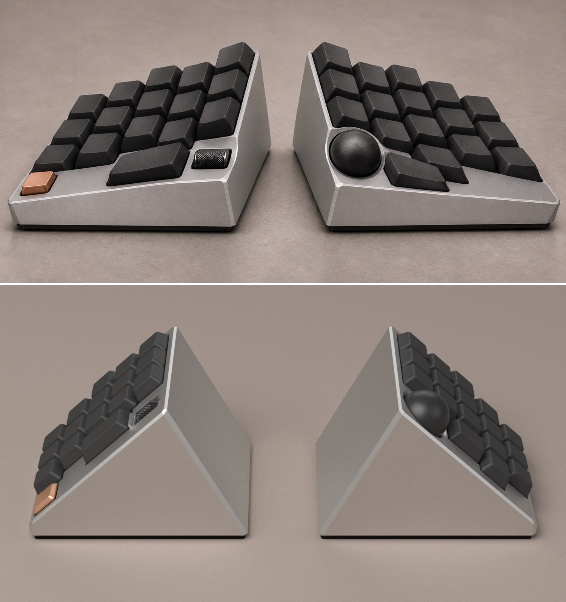

# Omnis A案ケース（版A-1）

Omnisの左右それぞれを「プレート」と「傾斜台」に分けた、3Dプリンター用の試作ケースです。キー面は左右に43°傾き、内側（親指側）が高くなります。前後には傾けていません。スイッチはKailh Choc V2、キーのピッチは17 mmです。形はPythonで作っていて、寸法や角度を変えてSTLを出し直せます。



上が参考画像（`reference/chamfer-inner-wheel.jpg`）、下がA-1のプレビュー（`preview/hero.jpg`）です。どちらも手前のやや上から左右を並べて見ています。プレビューは全体が画面に収まるように引いているので、縮尺は参考画像の約0.86倍です。

## 参考画像との違い

いちばん大きい違いは傾きです。参考画像のケースは、A-1の形でいえば約20°の傾きに当たる低さで描かれています。A-1のプレートを20°の傾斜台に載せ、参考画像と同じカメラで描くと、形はほぼ重なります。15°と25°でも重ねて比べ、20°がいちばん近いことを確かめました。


上が参考画像、下がその図（`preview/tilt20.jpg`）です。この図は説明のために描いたもので、`stl/` の傾斜台は43°です。43°にすると、同じ幅のキー面が外側の端から63 mm上がり、ケースの高さは20°のときの45 mmから72 mmになります。キー面が外側を向くので、手前から見るとキーの上面が見えにくくなります。参考画像は内側の壁が奥ほど高く、キー面が奥へも少し上がって見えますが、A-1は前後には傾けていません。

43°の傾きと、前後に傾けないことは、A-1の依頼の条件です。参考画像と同じコミット（`8fa20bf`）にある正面図 `chamfer-front.svg` も約41°の楔で、A-1を真正面から見た形（`preview/front.jpg`）はこちらに近くなります。座った目の高さから見た図は `preview/seat.jpg`、プレートを平らに置いて真上から見た図は `preview/layout.jpg` にあります。


参考画像の見た目に近い低い傾斜台も、同じプレートのまま出せます（「角度だけを変える」）。

違いの一覧です。上から、見た目への影響が大きい順に並べました。

| どこが | 参考画像 | A-1 | なぜ |
| --- | --- | --- | --- |
| 全体の高さと形 | 低い楔。いちばん高い所で約45〜50 mm | 高さ72 mm。真正面から見ると三角形 | 参考画像は約20°に当たる低さで描かれている。依頼の条件の43°にすると、幅93 mmのキー面が63 mm上がる |
| キーの見え方 | キーの上面が手前を向いてよく見える | キー面が外側を向き、手前からは斜めに見える | 43°に傾け、前後には傾けないため |
| 手前の面 | 低い台形（高さ約11〜21 mm） | 三角形（外側9.5 mm、内側73 mm） | 同上 |
| 内側の壁 | ほぼ垂直（約8°） | 垂直から28°寝かせた1枚の面 | キーを押す力はキー面に垂直で、43°では内側へ向く。垂直に近い壁だと、内側の列を約1 Nで押すと内側へ倒れ始める。28°で約5.4 N |
| 幅 | 片手で約98 mm | 105 mm | 内側の壁を寝かせたぶん、足元が内側へ37 mm広がる |
| 合わせ目 | なし | 上面の縁から2 mm下に、細い線が一周する | 角度だけ作り直せるよう、プレートと傾斜台を別の部品にしたため。線は上面の面取りのすぐ下に置いた |
| 球の位置 | 内側と手前の縁に接するほど角に寄る | 中心が内側の縁から17.7 mm、手前の縁から16.7 mm | 43°では内側の角が薄い楔になり、角に寄せると直径25 mmの球が内側の壁を突き抜ける。穴のまわりに1 mmの肉も残した |
| 球の出方 | 半分以上が上面から出る | 直径の46%（11.4 mm）が出る | 傾いた面で球が低い側へ転がり出ないよう、球の中心を上面より1.1 mm下にした |
| ホイール | 窓が約17×9 mm。内側の縁のすぐ脇 | 直径10 mm、長さ15 mm。窓は15.8×11.0 mmで、内側の縁から6.3 mm離れる | 球と同じく内側の角が薄く、軸を受ける溝のまわりに肉が要るため |
| ホイールの表面 | 細かいあや目 | 18条、深さ0.45 mmの粗いあや目 | 0.4 mmのノズルで出せる細かさに合わせた |
| 左の親指キー | 幅が約2uで、少し回っている | 幅1.75u（29.25 mm）で、回していない | ホイールが外側へ寄ったぶん、2uだと薬指の列の手前のキーに当たる |
| 右の親指キー | 幅広のキーが2個 | 1.25u（Enter）と1uが1個ずつ | 球の穴と薬指の列の間に収めるため |
| 親指キーの手前の空き | 手前の縁まで約3〜8 mm | 約12.5 mm | 音声入力キーのスイッチと球の穴をプレートの中に収めるには、手前の縁を約5 mm手前に出す必要があった |
| 音声入力キー | 約12 mm角で、くぼみに沈む | 14 mm角。スイッチを2 mm沈め、キャップは上面から2.5 mm出る | Choc V2のつば（15 mm角）をくぼみに通すため。14 mm角のキャップはハウジングをまたげない |
| キーのまわりの縁 | 約2〜3 mm | 内側4.2 mm、奥3.6 mm | 縁の下に、傾斜台の壁（2.4 mm）とプレートの差し込み部の肉を取るため |
| 列のずれ | 内側の人差し指の列がいちばん奥に見える | 中指を基準に、小指−14、薬指−8、人差し指−3、内側の人差し指−2 mm | 依頼の条件の「中指の列は奥、小指の列は手前」に合わせた。小指と薬指は参考画像から読んだ値（−13.6、−7.9）に近い |
| Spaceとホイールの仕切り | ほぼ平ら | 幅2 mm、高さ2.2 mmの畝 | Spaceを押した親指がホイールへ流れないようにするため。ホイールの頂点より0.2 mm高い |
| 奥の外側の角 | 見えない | 斜めに落とした（幅34 mm、奥行き12.4 mm） | キーのない上面を減らすため |
| キーキャップ | 丸みのある、背の高いキャップ | プレビューは `stl/` の印刷用キャップの形（16.5 mm角、上面は平ら） | 使うキーキャップで変わる。17 mmピッチでは外形16.5 mm以下が要る |
| 足 | 黒い足が全周で引っ込む | 高さ2.0 mm、引っ込み2.0 mm。色は傾斜台と同じ | 傾斜台と一体で印刷するため。黒にするには途中でフィラメントを替える |
| 素材と表面 | 梨地のアルミ | PLA。積層の筋が出る | 試作は3Dプリンターで作るため |

合っている所は、銀色の面取りした平らな面でできた閉じた楔形、細く引っ込んだ足、片手5列×3段の縦にずれた文字キー、右の内側手前の球、左の内側手前の横軸のホイール、左の外側手前の銅色の小さいキー、親指キーの位置です。

## 印刷する部品


STLはどれも印刷する向きで保存してあります。スライサーに読み込んだら、向きを変えずに造形面へ置いてください。番号は上の図と同じです。

| 番号 | ファイル | 部品 | 造形面に置く面 | サポート | 印刷時間 | 重さ |
| --- | --- | --- | --- | --- | --- | --- |
| 1 | `stl/left_plate.stl` | 左のプレート | 下面 | 不要 | 44分 | 16.2 g |
| 2 | `stl/right_plate.stl` | 右のプレート | 下面 | 不要 | 41分 | 15.0 g |
| 3 | `stl/left_base.stl` | 左の傾斜台 | 足（机に置く向き） | 不要 | 1時間23分 | 43.1 g |
| 4 | `stl/right_base.stl` | 右の傾斜台 | 足（机に置く向き） | 不要 | 1時間22分 | 43.1 g |
| 5 | `stl/left_wheel.stl` | ホイール | 端面（軸を立てる） | 不要 | 15分 | 0.8 g |
| 6 | `stl/fit_test.stl` | スイッチ穴の試し刷り | 下面 | 不要 | 11分 | 1.9 g |
| 7 | `stl/keycap_1u.stl` | キーキャップ 1u（任意、31個） | 上面 | 不要 | 11分 | 0.8 g |
| 8 | `stl/keycap_space.stl` | 左の親指キーのキャップ（任意） | 上面 | 不要 | 11分 | 1.2 g |
| 9 | `stl/keycap_enter.stl` | 右の親指キーのキャップ（任意） | 上面 | 不要 | 11分 | 1.0 g |
| 10 | `stl/keycap_voice.stl` | 音声入力キーのキャップ（任意） | 上面 | 不要 | 9分 | 0.5 g |
| | | 1個ずつの合計 | | | 5時間18分 | 123.6 g |

時間と重さは、BambuStudio 2.9.1のCLIでスライスした見積もりです。設定はこのMacのBambuStudioで選ばれていたBambu Lab A1 mini（0.4 mmノズル）、0.20mm Standard、Bambu PLA Basicの既定値で、サポートは使っていません。スライスしただけで、実際には印刷していません。キーキャップは1個ずつ刷った場合の値です。

- 本番の前に `fit_test.stl` を印刷し、スイッチがはまる穴を選んでください。穴は14.0、14.1、14.2 mmの3通りで、手前の刻みの数（1〜3本）で見分けます。プレートの穴は14.1 mmです。別の大きさが合うなら `--set hole=14.2` のように変えて出し直します。
- プレートは下面を造形面に置きます。見えている上面は最後に印刷される面です。平らに見せたいときはスライサーのアイロンを使ってください。
- 足を黒にするときは、傾斜台の高さ2.0 mm（0.2 mm積層で10層め）が終わった所でフィラメントを黒から本体の色に替えます。
- 下に支えがないまま印刷する所は3種類あります。プレートの外周の合わせ目（張り出し0.4〜0.6 mm）、傾斜台の足の上の段（張り出し0.4 mm）、傾斜台のケーブルの切り欠きの上（8 mmの橋）です。
- キーキャップ4種とホイールは、実物のスイッチで確かめていません。十字の穴がきつい、またはゆるいときは `--set stem_slot=4.2,1.4` のように変えてください。

## 印刷のほかに要るもの

| もの | 数 | 補足 |
| --- | --- | --- |
| Kailh Choc V2 スイッチ | 34個 | 左17個、右17個 |
| キーキャップ（1u、外形16.5 mm以下、MX十字） | 31個 | 印刷しない場合 |
| 球（直径25 mm） | 1個 | |
| 1.75 mmのフィラメント | 18 mm | ホイールの軸 |
| ゴム足か滑り止めのシート | 左右で8枚ほど | 傾斜台の底の枠（幅9 mm）に貼る |

キーキャップは外形16.5 mm以下を前提にしました。Choc V2の軸はMXと同じ十字ですが、MX用のキーキャップはふつう約18 mm角で、17 mmピッチでは隣に当たります。ピッチは変えていません。docs/concept.md で17 mmピッチがいちばん手に合うとされているためです。17 mmピッチ用でChoc V2に合うキーキャップはBOOTHで売られています（「【17mmピッチ対応】低背シリンドリカル・キーキャップセット（Choc V2用/42keys）」「comugi caps」「KazyCap」。2026-11-22に商品ページがあることだけ確かめました）。左右の親指キーと音声入力キーは幅が1uと違うので、合う市販品がなければ `stl/` のキャップを印刷します。

## 組み立て

1. `fit_test.stl` でスイッチ穴の大きさを確かめます。
2. プレートにスイッチを上から挿します。音声入力キーのスイッチはほかより2 mm低い面に載ります。
3. スイッチの端子に配線します。端子はプレートの下面から約2 mm出ます。A-1に基板や電池の置き場はありません。
4. 左のプレートの窓にホイールを入れます。ホイールに1.75 mmのフィラメントを通し、両端を窓の脇の溝へ上から落とし込みます。フィラメントは18 mmに切ります。
5. 右のプレートの丸い穴に球を載せます。球は穴の中の3つの突起に載ります。
6. プレートを傾斜台に載せます。プレートの下の差し込み部が傾斜台の壁の内側に入り、外周の斜めの面どうしが当たって位置が決まります。ねじは使いません。
7. キーキャップを付けます。
8. 傾斜台の底の枠にゴム足を貼ります。キーを押す力には机に平行な向きの成分があるので、滑り止めがないと打鍵で滑る見込みです。

プレートは載っているだけなので、キーキャップやスイッチを抜くときは手で押さえてください。奥の壁の下には、ケーブルを通す切り欠き（幅13 mm、高さ6 mm）があります。

## STLとプレビューの出し直し

```sh
cd case/a
python3 -m venv .venv
.venv/bin/pip install -r requirements.txt

.venv/bin/python build.py      # stl/ にSTLを出す
.venv/bin/python check.py      # 形、穴の寸法、傾き、当たりを確かめて表にする
.venv/bin/python render.py     # preview/ に画像を出す
.venv/bin/python estimate.py   # BambuStudioで時間と重さを見積もる（任意）
```

Python 3.15で確かめました。`build.py` は書き出したSTLを読み直し、閉じた形でなければ止まります。`check.py` は表を `out/check-report.md` にも書き、設計値から外れた所があれば終了コード1で終わります。`render.py` にかかる時間はこのMacで20秒ほどです。`estimate.py` は `/Applications/BambuStudio.app` を使い、スライスするだけでプリンターには何も送りません。

寸法は `omnis_a/params.py` にまとめてあります。値を変えたら上の4つを順に実行してください。

## 角度だけを変える

傾斜台だけを別の角度で作れます。プレートはそのまま使えます。

```sh
.venv/bin/python build.py --tilt 48
```

`stl/left_base_tilt48.stl` と `stl/right_base_tilt48.stl` ができます。内側の壁はプレートの端面とひと続きの面になるよう、傾きと一緒に寝かせています。43°で28°、48°で33°です。38°から55°の間では、倒れ始める力は約5〜6 Nになります。

| 傾き | 内側の壁の寝かせ | 傾斜台の外寸（mm） | 倒れ始める力 |
| --- | --- | --- | --- |
| 20° | 5° | 95 × 88 × 43 | 約48 N |
| 38° | 23° | 101 × 88 × 66 | 6.1 N |
| 43°（A-1） | 28° | 105 × 88 × 71 | 5.4 N |
| 48° | 33° | 111 × 88 × 77 | 5.0 N |
| 55° | 40° | 122 × 88 × 84 | 4.7 N |

20°、38°、48°、55°で、閉じた形になり、プレートやスイッチと当たらないことを確かめました。`--tilt 20` が、参考画像に近い見た目の傾斜台です。

ほかの寸法は `--set 名前=値` で変えられます。変えた寸法がプレートにも関わるときは、`--out` で別の場所へ一式を出してください。

```sh
.venv/bin/python build.py --set ball_d=34 --set ball_rise=15.5 --set plate_t=6.2 --out out/ball34
```

これは球を直径34 mmにする例です。球を大きくするとプレートを厚くする必要があり、ケースの奥行きは9.5 mm増えます。この値で閉じた形になり、部品どうしが当たらないことを確かめました。

## 決めた寸法と理由

| 項目 | 値 | 理由 |
| --- | --- | --- |
| 傾き | 43°。内側が高い。前後の傾きなし | 依頼の条件のとおり |
| 内側の壁 | 垂直から28°寝かせる | 内側の列を押しても倒れにくくするため。倒れ始める力が5 Nを超えるいちばん小さい角度にした |
| 外側の端の高さ | 9.5 mm | 小指の列と音声入力キーのスイッチの端子が、底の枠から1.4 mm以上浮く高さ |
| ピッチ | 17 mm（列、段とも） | 依頼の条件と docs/concept.md のとおり |
| 列のずれ | 小指−14、薬指−8、中指0、人差し指−3、内側の人差し指−2 mm | 小指と薬指は参考画像から読んだ値に合わせた。内側の2列は、球やホイールとの間隔を取りつつ中指より手前にした |
| スイッチ穴 | 14.10 mm角 | 図面の下ハウジング13.95 mmに0.15 mmのすき間 |
| 穴のふちの板 | 厚さ0.8 mm。その下を45°で広げる | スイッチの爪が掛かる位置を、Choc系で使われる板厚1.2 mmとほぼ同じにしつつ、穴の間を深さ3.2 mmのリブにして、支えなしで印刷できるようにするため |
| スイッチが載る面から上面まで | 4.5 mm | ハウジング（高さ3.1 mm）が上面より下に隠れ、押し切ったキーキャップが上面より下がらない高さ |
| プレートの厚み | 7.7 mm（上面から下面まで） | 上の4.5 mmに、リブの深さ3.2 mmを足した |
| 合わせ目 | 上面から2.0 mm下。外周0.4 mmは平らで、そこから45°で内へ下がる | 線を上面の面取りのすぐ下に置いて目立たなくし、斜めの面でプレートの位置を決めるため |
| プレートの差し込み部と傾斜台の壁のすき間 | 0.25 mm | 印刷の誤差があっても入るようにした。位置は外周の45°の面で決まる |
| 傾斜台の壁 | 2.4 mm | 0.4 mmのノズルで6本ぶん |
| 上面の面取り、縦の角の面取り | 1.2 mm、2.0 mm | 参考画像の光る縁の幅に合わせた |
| 足 | 高さ2.0 mm、引っ込み2.0 mm（45°の面取り1.6 mmと段0.4 mm） | 参考画像の比率に合わせた。面取りにしたのは支えなしで印刷するため |
| 球 | 直径25 mm。上面から11.4 mm出る | 参考画像の球は、見えている直径がキーピッチの約1.4倍（約24 mm）。市販の球で近いのが25 mm |
| 球の受け | 穴の中の3つの突起。球の真下から60°の位置で、1つは低い側（外側）に置く | 43°に傾けても球が突起に載ったままになる位置。プレートと一体で印刷できる |
| ホイール | 直径10 mm、長さ15 mm。上面から2.0 mm出る | 参考画像の窓（約17×9 mm）に近い大きさで、内側の角に収まる長さ |
| ホイールの軸 | 1.75 mmのフィラメント | 買い足さずに済む。窓の脇の溝に上から落とし込む |
| 左の親指キー | 1.75u。中心は人差し指の列の手前のキーから18 mm手前 | ホイールと薬指の列の間に収まる、いちばん広い幅 |
| 右の親指キー | 1.25uと1u | 球の穴と薬指の列の間に収まる幅 |
| 音声入力キー | 14 mm角。小指の列の手前、外側の角 | docs/concept.md の「ユニットの端を指一本で押せるか」を試せる位置。スイッチはほかと同じChoc V2 |
| 印刷用のキーキャップ | 外形16.5 mm角、上面約12 mm角、高さ6.2 mm | 17 mmピッチで隣と0.5 mmあく大きさ。下端はスイッチのつばに当たらない高さにした |

Choc V2の寸法はKailhの図面（CPG135301D03、2019-10-25）で確かめました。下ハウジング13.95±0.05 mm角、つば15.00 mm角、プレート上面からハウジング上端まで3.10 mm、軸の先端まで6.40 mm、ハウジングの底まで2.20 mm、ストローク3.2±0.25 mmです。図面にプレートの厚みの指定はありません。

## 確かめた結果

`check.py` の出力から抜き出しました。全文は `out/check-report.md` に出ます。

STLは10個とも、trimeshで読み直して閉じた形（watertight）でした。

| ファイル | 閉じた形 | 外寸 X × Y × Z（mm） | 体積（cm³） |
| --- | --- | --- | --- |
| `left_plate.stl` | はい | 94.6 × 88.3 × 9.9 | 20.0 |
| `right_plate.stl` | はい | 94.6 × 88.3 × 7.7 | 17.7 |
| `left_base.stl` | はい | 105.0 × 88.3 × 71.1 | 40.0 |
| `right_base.stl` | はい | 105.0 × 88.3 × 71.1 | 40.0 |
| `left_wheel.stl` | はい | 10.0 × 10.0 × 15.0 | 0.9 |
| `keycap_1u.stl` | はい | 16.5 × 16.5 × 7.9 | 0.6 |
| `keycap_space.stl` | はい | 29.2 × 16.5 × 7.9 | 1.0 |
| `keycap_enter.stl` | はい | 20.8 × 16.5 × 7.9 | 0.7 |
| `keycap_voice.stl` | はい | 14.0 × 14.0 × 6.4 | 0.3 |
| `fit_test.stl` | はい | 59.0 × 21.0 × 3.2 | 1.7 |

組んだときの片手ぶんの外寸は、ケースだけで幅105.0×奥行き88.3×高さ72.1 mm、キーキャップと球まで入れると高さ72.6 mmです。

スイッチ穴はSTLを穴のふちの板の厚みの中ほどで切って測りました。

| 側 | キー | 穴の数 | 幅（mm） | 奥行き（mm） |
| --- | --- | --- | --- | --- |
| 左 | 文字キー | 15 | 14.10 | 14.10 |
| 左 | 親指キー | 1 | 14.10 | 14.10 |
| 左 | 音声入力キー | 1 | 14.10 | 14.10 |
| 右 | 文字キー | 15 | 14.10 | 14.10 |
| 右 | 親指キー | 2 | 14.10 | 14.10 |

設計値14.10 mmからのずれは0.000 mm、列と段のピッチはどちらも17.00 mmでした。

- 傾斜台のSTLで、プレートが載る面は手前と奥のどちらの縁でも水平から43.00°、前後の傾きは0.00°、内側の壁は垂直から28.00°でした。
- プレート、傾斜台、スイッチ、キーキャップ、ホイール、球を組んだ位置に置くと、キーを押していないときも押し切ったときも、重なる体積はどの組み合わせも0 mm³でした。プレートと傾斜台、プレートと球は触れて載っています。ほかのすき間は、プレートとスイッチの下ハウジングが0.07 mm、プレートとキーキャップが0.60 mm、プレートとホイールが0.40 mm、傾斜台とスイッチの端子が1.69 mmです。
- 印刷する向きで下を向いた斜面は、どのSTLも垂直から47°以内でした。天井になるのは上の「印刷する部品」に書いた3種類だけです。BambuStudioでスライスした結果でも、サポートは使われていません。
- コミットした `case/a/` を別のフォルダに取り出し、上の手順でvenvを作ってSTLを出し直すと、10個ともコミットしたSTLと同じ内容になりました。

倒れにくさは計算上の目安です。キーをキー面に垂直に押したとして、押す力の向きを机まで延ばした点が足の内側なら、どれだけ強く押しても倒れません。外側に出るのは内側の人差し指の列だけで、足の縁から14.5 mm外に出ます。ここを左は5.4 N（約552 gf）、右は5.8 N（約589 gf）で押すと倒れ始めます。重さは左105 g、右113 gと見積もりました。

| 内側の壁の寝かせ | 足の幅（mm） | 倒れ始める力 |
| --- | --- | --- |
| 9° | 75 | 1.1 N |
| 15° | 83 | 1.6 N |
| 20° | 90 | 2.4 N |
| 25° | 97 | 3.8 N |
| 28°（A-1） | 102 | 5.4 N |
| 32° | 108 | 11.1 N |

この表は外形を変えずに壁の角度だけを変えたとして計算した値です。実際に壁を参考画像に近い9°まで立てると、内側の列のスイッチが壁に当たるので、内側の縁も3 mm広げる必要があります（`--set lean_nominal=9 --set margin_inner=7.8 --out out/lean9`）。その形は約1.3 Nで倒れ始めます。

## まだ確かめていないこと

- 実物は印刷していません。スイッチのはまり具合、プレートと傾斜台の合い方、積層の見え方は分かっていません。
- 倒れにくさは計算上の目安で、実際の打鍵で揺れないかは分かっていません。
- 印刷用のキーキャップ4種とホイールは、図面の寸法だけで作っています。
- 「小人キー」の実物の傾きは測っていません。43°は依頼文の値をそのまま使いました。
- 配線、基板、電池、センサーの置き場はA-1にありません。
